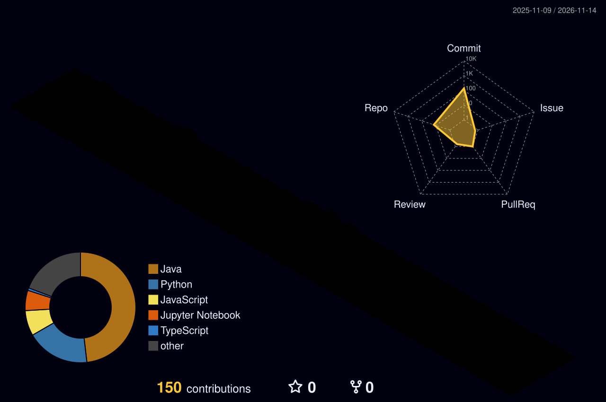

<!-- ===================== HEADER ===================== -->
<p align="center">
  
</p>

<p align="center">
  <a href="https://github.com/JosueVele77">
    
  </a>
</p>

<p align="center">
  <a href="https://github.com/JosueVele77?tab=followers"></a>
  
  <a href="mailto:josueasifuela@gmail.com"></a>
</p>

---

## 👨‍💻 About Me

```ts
const josue = {
  role: "Full Stack Developer",
  location: "Ecuador 🇪🇨",
  focus: ["Modern web apps", "REST & type-safe APIs", "Clean architecture"],
  currentlyLearning: ["Python", "React / Next.js", "Docker", "AWS", "AI-powered apps"],
  goal: "Become a professional full stack engineer 🎯",
  funFact: "I love turning ideas into real-world applications 💡",
};
```

- ⚡ I work across **frontend & backend**, from UI to database.
- 🌱 Leveling up in **Python 🐍, React ⚛️ and cloud tooling ☁️**.
- 🤖 Exploring how to build apps with **AI / LLM APIs**.
- 📫 Reach me at **josueasifuela@gmail.com**

---

## 🛠️ Tech Stack

<h3 align="center">💻 Languages</h3>
<p align="center">
  
</p>

<h3 align="center">🎨 Frontend</h3>
<p align="center">
  
</p>

<h3 align="center">⚙️ Backend</h3>
<p align="center">
  
</p>

<h3 align="center">🗄️ Databases & ORM</h3>
<p align="center">
  
  <br/>
  
</p>

<h3 align="center">☁️ DevOps & Cloud</h3>
<p align="center">
  
</p>

<h3 align="center">🧰 Tools</h3>
<p align="center">
  
</p>

---

## 📊 GitHub Analytics

<p align="center">
  
</p>

<p align="center">
  
  
</p>

<p align="center">
  
  
</p>

<p align="center">
  
</p>

---

## 🌈 3D Contributions

<p align="center">
  
</p>

---

## 🐍 Contribution Snake

<p align="center">
  <picture>
    <source media="(prefers-color-scheme: dark)" srcset="https://raw.githubusercontent.com/JosueVele77/JosueVele77/output/github-contribution-grid-snake-dark.svg" />
    <source media="(prefers-color-scheme: light)" srcset="https://raw.githubusercontent.com/JosueVele77/JosueVele77/output/github-contribution-grid-snake.svg" />
    
  </picture>
</p>

---

## 🤝 Connect with me

<p align="center">
  <a href="https://github.com/JosueVele77">
    
  </a>
  <a href="mailto:josueasifuela@gmail.com">
    
  </a>
</p>

<p align="center">
  
</p>

<!-- ===================== FOOTER ===================== -->
<p align="center">
  
</p>
